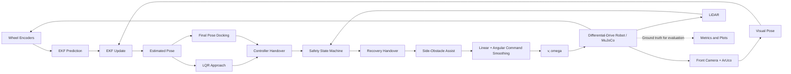

# 41014 Integrated Project — Mobile Robot Visual Docking

**Subject:** 41014 Sensors and Control for Mechatronic Systems  
**Track:** Track A — Mobile robot visual waypoint navigation / visual docking  
**Robot:** TurtleBot3 Waffle Pi geometry in MuJoCo with planar differential-drive kinematics  
**Core pipeline:** Wheel encoders + camera/ArUco → EKF → LQR / final pose controller  
**Robustness extension:** LiDAR safety override, obstacle recovery, side-obstacle assist and command smoothing

## Project overview

This project implements an end-to-end sensing, estimation and control pipeline for a differential-drive mobile robot in MuJoCo. The robot starts with lateral and heading error, estimates its pose from noisy wheel encoders and intermittent ArUco-camera measurements, avoids an obstacle, recovers toward the docking line, and finishes at a target pose.

The controller uses the **EKF estimated state only**. MuJoCo ground truth is used only to calculate evaluation metrics and to drive the simulated sensor geometry.

The final docking target is

```math
\mathbf{x}_d=
\begin{bmatrix}
1.30 & 0 & 0
\end{bmatrix}^{T}
```

corresponding to \(x=1.30\text{ m}\), \(y=0\text{ m}\), and \(\theta=0^\circ\).

---

## 1. System architecture



### Coordinate frames

- **World frame \(\{W\}\):** fixed MuJoCo map frame.
- **Robot/body frame \(\{B\}\):** attached to the Waffle Pi body.
- **Camera frame \(\{C\}\):** attached to the front camera.
- **ArUco marker frame \(\{M\}\):** fixed at the docking station.

The camera detects the known marker and estimates marker-to-camera pose. This measurement is transformed into robot pose in the world frame before the EKF update.

---

## 2. Robot model

The robot state and control input are

```math
\mathbf{x}=\begin{bmatrix}x & y & \theta\end{bmatrix}^{T},
\qquad
\mathbf{u}=\begin{bmatrix}v & \omega\end{bmatrix}^{T}.
```

The unicycle kinematic model is

```math
\dot{x}=v\cos\theta,\qquad
\dot{y}=v\sin\theta,\qquad
\dot{\theta}=\omega.
```

For wheel radius \(r\), wheelbase \(L\), and wheel angular velocities \(\omega_R,\omega_L\),

```math
v=\frac{r}{2}(\omega_R+\omega_L),
\qquad
\omega=\frac{r}{L}(\omega_R-\omega_L).
```

### Final model parameters

| Parameter | Value |
|---|---:|
| Simulation time step, \(\Delta t\) | 0.05 s |
| Wheel radius, \(r\) | 0.033 m |
| Wheelbase, \(L\) | 0.288 m |
| Maximum forward speed | 0.18 m/s |
| Maximum forward acceleration | 0.12 m/s² |
| Maximum angular acceleration during normal control | 1.5 rad/s² |
| Simulation duration | 25 s |

The MuJoCo model uses TurtleBot3 Waffle Pi meshes and dimensions while preserving the project’s planar \(x,y,\theta\) state representation.

---

## 3. Sensing

### Wheel encoders

Wheel angular velocity is corrupted with bias and Gaussian noise:

```math
\omega_m=\omega_{\text{true}}+b+\eta,
\qquad
\eta\sim\mathcal N(0,\sigma^2).
```

| Encoder parameter | Value |
|---|---:|
| Noise standard deviation | 0.15 rad/s |
| Left-wheel bias | 0.00 rad/s |
| Right-wheel bias | 0.02 rad/s |

### Camera and ArUco marker

The front camera detects ArUco marker ID 0. OpenCV `solvePnP` estimates marker pose from the marker corners and camera model.

| Camera parameter | Value |
|---|---:|
| Image size | 640 × 480 |
| Field of view | 90° |
| Marker side length | 0.30 m |
| Camera update interval | every 5 simulation steps |
| Pose measurement standard deviation in \(x\) | 0.01 m |
| Pose measurement standard deviation in \(y\) | 0.01 m |
| Pose measurement standard deviation in heading | 1° |

### LiDAR and obstacle safety

The obstacle scenario uses left, front and right rays. The front ray drives a `NORMAL → AVOIDING → RECOVERY → NORMAL` safety state machine, while the side rays provide continuous corner clearance assistance around the Waffle Pi footprint.

| LiDAR / avoidance parameter | Value |
|---|---:|
| Maximum range | 3.5 m |
| Slow-obstacle distance | 0.75 m |
| Avoidance-entry distance | 0.40 m |
| Avoidance-exit distance | 0.75 m |
| Avoidance turn rate | 0.8 rad/s |
| Recovery speed | 0.10 m/s |
| Recovery duration | 4.5 s |
| Minimum avoidance duration | 0.75 s |
| Side influence distance | 0.55 m |
| Side hard distance | 0.30 m |
| Side maximum turn rate | 0.45 rad/s |

---

## 4. State estimator — Extended Kalman Filter

The EKF fuses noisy wheel-encoder motion with intermittent camera pose measurements.

### Prediction

```math
\hat{\mathbf{x}}_{k+1}^{-}=f(\hat{\mathbf{x}}_k,\mathbf{u}_k)
```

with

```math
f(\mathbf{x},\mathbf{u})=
\begin{bmatrix}
x+v\cos\theta\,\Delta t\\
y+v\sin\theta\,\Delta t\\
\theta+\omega\Delta t
\end{bmatrix}.
```

The process covariance used in the final simulation is

```math
Q=\mathrm{diag}\left(0.002^2,\;0.002^2,\;(0.5^\circ)^2\right).
```

### Camera update

The camera supplies direct pose measurements, so \(H=I\) when the marker is visible.

```math
K=P^-H^T(HP^-H^T+R)^{-1}
```

```math
\hat{\mathbf{x}}=\hat{\mathbf{x}}^-+K(\mathbf{z}-H\hat{\mathbf{x}}^-)
```

with

```math
R=\mathrm{diag}\left(0.01^2,\;0.01^2,\;(1^\circ)^2\right).
```

When the marker leaves the camera view, the EKF continues encoder-based prediction until another visual correction is available.

---

## 5. Controller design

The controller uses only the EKF estimate

```math
\hat{\mathbf{x}}=[\hat{x},\hat{y},\hat{\theta}]^T.
```

### Phase 1 — LQR approach

LQR regulates lateral and heading error before the final docking region.

```math
\mathbf{e}=\begin{bmatrix}e_y & e_\theta\end{bmatrix}^{T}
```

with weights

```math
Q_c=\begin{bmatrix}8&0\\0&4\end{bmatrix},
\qquad
R_c=[1.2].
```

and steering law

```math
\omega=-K\mathbf{e}.
```

| LQR parameter | Value |
|---|---:|
| \(q_y\) | 8.0 |
| \(q_\theta\) | 4.0 |
| \(r_\omega\) | 1.2 |
| Angular-rate limit | 1.5 rad/s |
| Maximum forward speed | 0.18 m/s |

### Phase 2 — final pose docking

When the EKF estimate reaches approximately

```math
\hat{x}\ge1.05\text{ m},
```

the project switches from LQR approach to the final pose controller.

| Docking parameter | Value |
|---|---:|
| Final docking start \(x\) | 1.05 m |
| Docking target \(x\) | 1.30 m |
| Slow-down distance | 0.50 m |
| Stop tolerance | 0.03 m |
| Final docking maximum angular speed | 0.5 rad/s |
| Final heading alignment gain | 0.8 |

### Command smoothing and handovers

To remove abrupt visible motion while preserving safety, the final simulation includes:

- **Recovery-to-normal handover:** 0.60 s blend from recovery speed back to the nominal controller.
- **LQR-to-final-dock handover:** 0.60 s blend between the last LQR command and the pose-controller command.
- **Linear acceleration limiter:** limits increases in forward speed to 0.12 m/s²; emergency deceleration remains unrestricted.
- **Angular slew-rate limiter:** limits angular acceleration to 1.5 rad/s² during `NORMAL` operation; direct avoidance turns are not rate-limited.

The safety layer is applied after the nominal controller, so obstacle avoidance retains priority over trajectory tracking and docking.

---

## 6. Final obstacle-scenario results

The final frozen obstacle simulation produced:

| Metric | Final result |
|---|---:|
| Camera updates | 21 |
| Final localisation error | 0.02079 m |
| Position RMSE | 0.03733 m |
| Final lateral error | −0.00167 m |
| Final heading error | 1.372° |
| Final X docking error | −0.00164 m |
| Final Y docking error | −0.00167 m |
| Final planar docking error | **0.00233 m** |
| Obstacle avoidance | Successful |

The final planar docking error is approximately **2.3 mm**. The larger whole-run heading RMSE is expected because it includes the deliberate avoidance turn and recovery manoeuvre rather than only the final docking phase.

The final state sequence is:

```text
LQR_APPROACH
→ NORMAL
→ AVOIDING
→ RECOVERY
→ NORMAL
→ FINAL_DOCK
```

### Final result figures


The simulation also saves overview, front-camera, bird’s-eye, top-view and four-view-grid videos under `results/obstacle/` when generated locally.

---

## 7. Installation

Tested development environment:

- Python 3.11.9
- Git
- VS Code
- MuJoCo
- NumPy
- SciPy
- Matplotlib
- OpenCV / ArUco

From a fresh clone:

```powershell
git clone <YOUR-GITHUB-REPOSITORY-URL>
cd 41014_Final_Project
```

Create and activate the virtual environment:

```powershell
python -m venv .venv
.venv\Scripts\activate
```

Install dependencies:

```powershell
python -m pip install --upgrade pip
pip install -r requirements.txt
```

---

## 8. Run instructions

Run commands from the repository root so the `src` package resolves correctly.

### Obstacle docking simulation

```powershell
python -m scripts.simulate_mujoco_obstacle_trial
```

Outputs are saved under:

```text
results/obstacle/
```

Typical outputs include:

```text
trajectory_history.csv
metrics.csv
trajectory.png
lateral_error.png
heading_error.png
control_commands.png
lidar_clearance.png
aruco_updates.png
latest_aruco_detection.png
simulation.mp4
robot_camera.mp4
birdseye_perspective.mp4
top_view.mp4
four_view_grid.mp4
```

### Nominal docking simulation

```powershell
python -m scripts.simulate_mujoco_nominal
```

Outputs are saved under `results/nominal/`.

If final nominal-versus-obstacle comparison numbers are required, rerun both scenarios with the frozen parameter set before regenerating the comparison report so both datasets use the same robot geometry and controller configuration.

---

## 9. Repository structure

```text
41014_Final_Project/
├── assets/                 # MuJoCo worlds, Waffle Pi meshes and simulation assets
├── src/                    # Model, sensors, EKF, controller, LiDAR and vision modules
├── scripts/                # Simulation and analysis scripts
├── results/
│   ├── nominal/
│   ├── obstacle/
│   └── comparison/
├── requirements.txt
└── README.md
```

---

## 10. Contribution statement

| Team member | Contribution |
|---|---|
| Gil Martin A. Guape | Developed and integrated the differential-drive simulation, EKF estimator, LQR and final-pose control workflow, LiDAR obstacle-avoidance logic, TurtleBot3 Waffle Pi MuJoCo environment, command-smoothing refinements, simulation testing, quantitative evaluation, visual outputs and project documentation. |

The complete sensing–estimation–control pipeline is understood as an integrated system for the individual viva voce.

---

## 11. Generative AI declaration

Generative AI was used as a support tool during project development. Final engineering decisions, code retained in the repository, executed results and explanations remain the responsibility of the student.

| Tool | Purpose | Verification |
|---|---|---|
| OpenAI ChatGPT | Coding guidance and debugging support; explanation of EKF/LQR and sensing concepts; assistance refining the MuJoCo simulation; README/documentation drafting; viva preparation | Suggestions were checked against project requirements, source code and executed simulation outputs before being retained. |

AI-generated suggestions were not treated as simulation evidence. Quantitative values reported on this page come from the executed project scripts and saved result files.

---

## 12. Limitations and hardware transition

The final MuJoCo implementation demonstrates the complete simulation pipeline, but hardware testing can introduce wheel slip, motor deadband, camera-calibration error, sensor latency, frame misalignment and different noise characteristics.

Two simulation-specific details require particular attention before hardware deployment:

1. The current MuJoCo safety implementation can identify named geometries such as `obstacle_1` and the docking panel. A physical robot cannot use simulator geometry names, so hardware obstacle classification should instead rely on LiDAR range sectors and geometric thresholds.
2. The simulation uses known planar robot pose to originate the LiDAR rays. On hardware, LiDAR measurements are naturally expressed in the sensor frame and must be transformed using the calibrated sensor-to-body transform.

The intended hardware architecture remains:

```text
Sensors → EKF → Estimated State → Nominal Controller → Safety Layer → Robot
```
