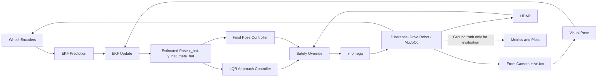
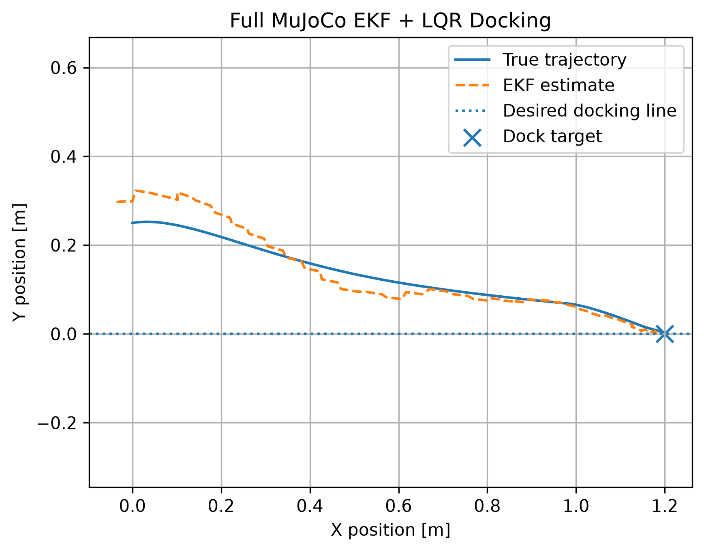
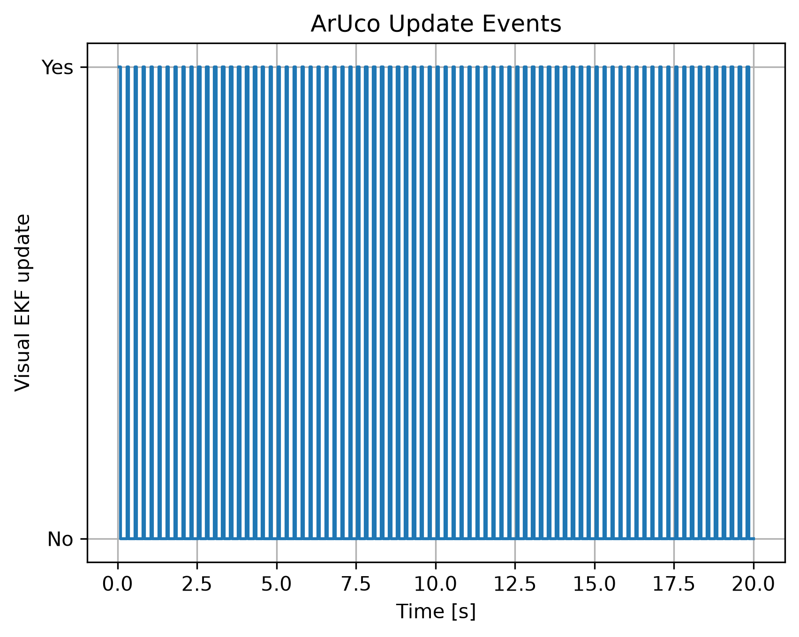

# 41014 Integrated Project — Mobile Robot Visual Docking

**Subject:** 41014 Sensors and Control for Mechatronic Systems  
**Track:** Track A — Mobile robot visual waypoint navigation / visual docking  
**Platform:** MuJoCo differential-drive mobile robot  
**Core pipeline:** Wheel encoders + camera/ArUco → EKF → LQR / final pose controller  
**Robustness extension:** LiDAR safety override for obstacle avoidance

## Project overview

This project implements an end-to-end sensing, estimation and control pipeline for a differential-drive mobile robot in MuJoCo. The robot starts with lateral and heading error, estimates its pose from noisy wheel encoders and intermittent ArUco-camera measurements, and docks at a target pose.

The controller uses the **EKF estimated state only**. MuJoCo ground truth is used only to calculate evaluation metrics.

Two scenarios are evaluated:

- **Nominal docking:** visual docking without an obstacle.
- **Obstacle docking:** the same estimator and controller, with a LiDAR safety state machine that can temporarily override the nominal command.

The docking target is

```math
\mathbf{x}_d =
\begin{bmatrix}
1.20 & 0 & 0
\end{bmatrix}^{T}
```

for $x=1.20\text{ m}$, $y=0\text{ m}$, and $\theta=0^\circ$.

---

## 1. System architecture



### Coordinate frames

The main frames are:

- **World frame $\{W\}$:** fixed MuJoCo map frame.
- **Robot/body frame $\{B\}$:** attached to the differential-drive robot.
- **Camera frame $\{C\}$:** attached to the front camera.
- **ArUco marker frame $\{M\}$:** fixed at the docking station.

The camera detects the known marker and estimates marker-to-camera pose. This is transformed into a robot pose in the world frame before the EKF measurement update.

---

## 2. Robot model

The robot state and control input are

```math
\mathbf{x}=
\begin{bmatrix}
x & y & \theta
\end{bmatrix}^{T},
\qquad
\mathbf{u}=
\begin{bmatrix}
v & \omega
\end{bmatrix}^{T}.
```

The unicycle kinematic model is

```math
\dot{x}=v\cos\theta,\qquad
\dot{y}=v\sin\theta,\qquad
\dot{\theta}=\omega.
```

For a differential-drive robot with wheel radius $r$, wheelbase $L$, and wheel angular velocities $\omega_R,\omega_L$,

```math
v=\frac{r}{2}(\omega_R+\omega_L),
\qquad
\omega=\frac{r}{L}(\omega_R-\omega_L).
```

### Model parameters

| Parameter | Value |
|---|---:|
| Simulation time step, $\Delta t$ | 0.05 s |
| Wheel radius, $r$ | 0.033 m |
| Wheelbase, $L$ | 0.16 m |
| Maximum forward speed | 0.18 m/s |
| Simulation duration | 20 s |

### Controllability used for LQR approach

The LQR approach controller uses the small-error states

```math
\mathbf{e}=
\begin{bmatrix}
e_y & e_\theta
\end{bmatrix}^{T}.
```

For approximately constant forward speed $v$,

```math
\dot{\mathbf{e}}
=
\begin{bmatrix}
0 & v\\
0 & 0
\end{bmatrix}\mathbf{e}
+
\begin{bmatrix}
0\\
1
\end{bmatrix}\omega.
```

The controllability matrix is

```math
\mathcal{C}=[B\ AB]
=
\begin{bmatrix}
0 & v\\
1 & 0
\end{bmatrix}.
```

For $v\neq0$, $\mathrm{rank}(\mathcal C)=2$, so the lateral-heading error model is controllable.

---

## 3. Sensing

### Wheel encoders

Wheel angular velocity is deliberately corrupted to prevent unrealistically perfect odometry:

```math
\omega_m=\omega_{\text{true}}+b+\eta,
\qquad
\eta\sim\mathcal N(0,\sigma^2).
```

| Encoder parameter | Value |
|---|---:|
| Noise standard deviation | 0.15 rad/s |
| Left-wheel bias | 0.00 rad/s |
| Right-wheel bias | 0.02 rad/s |

This causes odometry drift and gives the EKF a meaningful estimation problem.

### Camera and ArUco marker

The front camera detects ArUco marker ID 0. OpenCV `solvePnP` estimates the marker pose using the detected corners, marker geometry, camera matrix and zero simulated distortion.

| Camera parameter | Value |
|---|---:|
| Image size | 640 × 480 |
| Field of view | 90° |
| ArUco marker side length | 0.30 m |
| Camera update interval | every 5 simulation steps |
| Pose noise in $x$ | 0.01 m |
| Pose noise in $y$ | 0.01 m |
| Pose noise in heading | 1° |

### LiDAR

The obstacle scenario adds left, front and right range rays. LiDAR does not replace the nominal controller; it is used as a supervisory safety layer.

| LiDAR / avoidance parameter | Value |
|---|---:|
| Maximum range | 3.5 m |
| Slow-obstacle distance | 0.65 m |
| Avoidance-entry distance | 0.30 m |
| Avoidance-exit distance | 0.60 m |
| Avoidance turn rate | 0.8 rad/s |
| Recovery speed | 0.10 m/s |

---

## 4. State estimator — Extended Kalman Filter

The EKF fuses noisy encoder motion with intermittent camera pose measurements.

### Prediction

```math
\hat{\mathbf{x}}_{k+1}^{-}
=
f(\hat{\mathbf{x}}_k,\mathbf{u}_k)
```

with

```math
f(\mathbf{x},\mathbf{u})=
\begin{bmatrix}
x+v\cos\theta\,\Delta t\\
y+v\sin\theta\,\Delta t\\
\theta+\omega\Delta t
\end{bmatrix}.
```

The state Jacobian is

```math
F_k=
\begin{bmatrix}
1 & 0 & -v\sin\theta\,\Delta t\\
0 & 1 &  v\cos\theta\,\Delta t\\
0 & 0 & 1
\end{bmatrix},
```

and covariance prediction is

```math
P_{k+1}^{-}=F_kP_kF_k^T+Q.
```

Current process covariance:

```math
Q=
\mathrm{diag}
\left(
0.002^2,\;
0.002^2,\;
(0.5^\circ)^2
\right).
```

### Camera update

The camera supplies a pose measurement

```math
\mathbf{z}=
\begin{bmatrix}
x_c & y_c & \theta_c
\end{bmatrix}^{T}
```

with direct pose measurement model $H=I$.

```math
K=P^-H^T(HP^-H^T+R)^{-1}
```

```math
\hat{\mathbf{x}}
=
\hat{\mathbf{x}}^-+
K(\mathbf{z}-H\hat{\mathbf{x}}^-).
```

The measurement covariance is

```math
R=
\mathrm{diag}
\left(
0.01^2,\;
0.01^2,\;
(1^\circ)^2
\right).
```

Because $H=I$ when the marker is visible, all three pose states are directly observed by the visual pose update. When the marker is not visible, the EKF continues encoder-based prediction and uncertainty grows until visual correction becomes available again.

---

## 5. Controller design

The controller uses the EKF estimate

```math
\hat{\mathbf{x}}=
[\hat{x},\hat{y},\hat{\theta}]^T
```

and never the simulator ground truth.

### Phase 1 — LQR approach

Before the final docking region, LQR corrects lateral and heading error.

```math
J=
\int
\left(
\mathbf{e}^TQ_c\mathbf{e}
+
\omega^TR_c\omega
\right)dt
```

with

```math
Q_c=
\begin{bmatrix}
8&0\\
0&4
\end{bmatrix},
\qquad
R_c=[1.2].
```

The steering law is

```math
\omega=-K\mathbf{e}.
```

| LQR parameter | Value |
|---|---:|
| $q_y$ | 8.0 |
| $q_\theta$ | 4.0 |
| $r_\omega$ | 1.2 |
| Angular-rate limit | 1.5 rad/s |
| Maximum forward speed | 0.18 m/s |

The larger lateral-error weight makes centreline convergence the main objective while $R_c$ prevents unnecessarily aggressive steering.

### Phase 2 — final pose docking

At approximately

```math
\hat{x}\ge0.95\text{ m},
```

the controller switches to a final pose controller. It regulates remaining position and heading error and slows the robot near the target.

| Docking parameter | Value |
|---|---:|
| Final docking start $x$ | 0.95 m |
| Slow-down distance | 0.50 m |
| Stop tolerance | 0.03 m |

The obstacle scenario applies the LiDAR state machine after the nominal LQR / pose-control command, so collision avoidance can temporarily override the nominal command.

---

## 6. Quantitative results

The comparison is generated directly from the submitted code using:

```powershell
python -m scripts.compare_final_results
```

The script reads the nominal and obstacle metrics and writes:

```text
results/comparison/comparison_metrics.csv
results/comparison/final_results_summary.txt
results/comparison/camera_update_comparison.png
results/comparison/docking_error_comparison.png
```

### Latest simulation results

| Metric | Nominal | Obstacle |
|---|---:|---:|
| Camera updates | 80 | 44 |
| Final localisation error | 0.01124 m | 0.00748 m |
| Position RMSE | 0.03069 m | 0.05590 m |
| Final planar docking error | 0.01119 m | 0.01037 m |
| Final heading error | −2.339° | 2.597° |
| Obstacle avoidance | N/A | Successful |

The obstacle trial produced fewer camera updates and a higher position RMSE because obstacle avoidance changes the path and temporarily reduces the quality/frequency of visual correction. However, the final localisation error and final planar docking error remained close to 1 cm, showing that the estimator and final docking controller recovered after avoidance.

The obstacle safety state machine completed the sequence:

```text
NORMAL → AVOIDING → RECOVERY → NORMAL → FINAL_DOCK
```

### Example result figures

The following figures are committed in the repository and therefore render directly on GitHub. The comparison script also generates additional comparison figures locally under `results/comparison/`; commit that folder if you want those comparison plots to appear on the project page.





---

## 7. Installation

Tested development environment:

- Python 3.11.9
- Git
- VS Code
- MuJoCo
- NumPy
- SciPy
- Matplotlib
- OpenCV / ArUco

From a fresh clone:

```powershell
git clone <YOUR-GITHUB-REPOSITORY-URL>
cd 41014_Final_Project
```

Create and activate the virtual environment:

```powershell
python -m venv .venv
.venv\Scripts\activate
```

Install dependencies:

```powershell
python -m pip install --upgrade pip
pip install -r requirements.txt
```

---

## 8. Run instructions

Run all commands from the repository root so the `src` package is resolved correctly.

### Nominal docking simulation

```powershell
python -m scripts.simulate_mujoco_nominal
```

Outputs are saved under:

```text
results/nominal/
```

### Obstacle docking simulation

```powershell
python -m scripts.simulate_mujoco_obstacle_trial
```

Outputs are saved under:

```text
results/obstacle/
```

### Compare the final results

```powershell
python -m scripts.compare_final_results
```

Outputs are saved under:

```text
results/comparison/
```

The main simulation code records trajectories, localisation errors, lateral/heading errors, docking errors, camera updates and video outputs.

---

## 9. Repository structure

```text
41014_Final_Project/
├── assets/                 # MuJoCo worlds and simulation assets
├── src/                    # Robot model, sensors, EKF, controller and LiDAR modules
├── scripts/                # Nominal, obstacle and comparison scripts
├── results/
│   ├── nominal/
│   ├── obstacle/
│   └── comparison/
├── requirements.txt
└── README.md
```

---

## 10. Contribution statement

> **Complete this table with the agreed team contribution record before final submission.**  
> Contributions should describe what each person actually implemented, tested, analysed or documented.

| Team member | Contribution |
|---|---|
| Gil Martin A. Guape | [Replace with agreed contribution statement — e.g. modelling, EKF/controller integration, simulation testing, quantitative comparison, documentation.] |


All team members are expected to understand the complete sensing-estimation-control pipeline for the individual viva voce.

---

## 11. Generative AI declaration

Generative AI was used as a support tool during project development. The submitted design decisions, code, results and explanations remain the responsibility of the project team.

| Tool | Purpose | Verification |
|---|---|---|
| OpenAI ChatGPT | Coding guidance and debugging support; explanation of EKF/LQR concepts; README/documentation drafting; preparation for simulation review and viva questions | Generated suggestions were checked against the lecture material, project code and executed simulation outputs before being retained. |


AI-generated suggestions were not treated as simulation evidence. Quantitative values reported above come from the project scripts and saved result files.

---

## 12. Key limitations and next step

The current results demonstrate the complete pipeline in MuJoCo, but simulation does not reproduce all hardware effects. Real testing may require retuning because of wheel slip, motor deadband, camera calibration error, sensor latency, frame alignment and different measurement noise.

The next stage is staged hardware validation while keeping the same architecture:

```text
Sensors → EKF → Estimated State → Controller → Robot
```

A quantitative simulation-versus-hardware comparison will be used to evaluate how the system changes on the physical platform.
