# 41014 Integrated Project — Mobile Robot Visual Docking

**Subject:** 41014 Sensors and Control for Mechatronic Systems  
**Track:** Track A — Mobile robot visual waypoint navigation / visual docking  
**Robot:** TurtleBot3 Waffle Pi geometry in MuJoCo with planar differential-drive kinematics  
**Core pipeline:** Wheel encoders + camera/ArUco → EKF → LQR / final pose controller  
**Robustness extension:** LiDAR safety override, obstacle recovery, side-obstacle assist and command smoothing

## Project overview

This project implements an end-to-end sensing, estimation and control pipeline for a differential-drive mobile robot in MuJoCo. The robot estimates its planar pose from noisy wheel-encoder measurements and intermittent ArUco-based camera measurements, follows a docking path using an EKF-informed controller, avoids an obstacle using LiDAR, recovers toward the docking line, and finishes at the target pose.

The controller uses the **EKF-estimated state only**. MuJoCo ground truth is retained for evaluation and simulated sensor geometry, not for nominal feedback control.

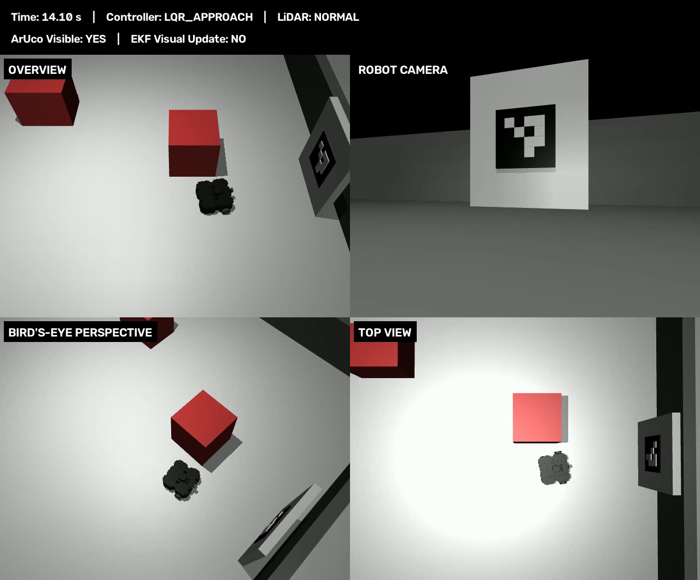

### Final docking target

The desired docking pose is

```math
\mathbf{x}_d =
\begin{bmatrix}
1.30 \\
0 \\
0
\end{bmatrix}
```

where

```math
x_d = 1.30\ \mathrm{m},
\qquad
y_d = 0\ \mathrm{m},
\qquad
\theta_d = 0^\circ.
```

---

## 1. System architecture

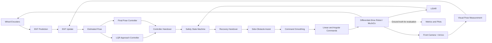

### Coordinate frames

- **World frame \(\{W\}\):** fixed MuJoCo map frame.
- **Robot/body frame \(\{B\}\):** attached to the TurtleBot3 Waffle Pi body.
- **Camera frame \(\{C\}\):** attached to the front camera.
- **ArUco marker frame \(\{M\}\):** fixed at the docking station.

The camera estimates the marker-to-camera pose, which is transformed into robot pose in the world frame before the EKF measurement update.

---

## 2. Robot model

The planar robot state is

```math
\mathbf{x} =
\begin{bmatrix}
x \\
y \\
\theta
\end{bmatrix},
```

and the control input is

```math
\mathbf{u} =
\begin{bmatrix}
v \\
\omega
\end{bmatrix},
```

where \(v\) is linear velocity and \(\omega\) is angular velocity.

The unicycle kinematic model is

```math
\dot{x} = v\cos\theta,
\qquad
\dot{y} = v\sin\theta,
\qquad
\dot{\theta} = \omega.
```

For wheel radius \(r\), wheelbase \(L\), and right/left wheel angular velocities \(\omega_R\) and \(\omega_L\),

```math
v = \frac{r}{2}\left(\omega_R+\omega_L\right),
```

```math
\omega = \frac{r}{L}\left(\omega_R-\omega_L\right).
```

### Final model parameters

| Parameter | Value |
|---|---:|
| Simulation time step, \(\Delta t\) | 0.05 s |
| Wheel radius, \(r\) | 0.033 m |
| Wheelbase, \(L\) | 0.288 m |
| Maximum forward speed | 0.18 m/s |
| Maximum forward acceleration | 0.12 m/s² |
| Maximum angular acceleration during normal control | 1.5 rad/s² |
| Simulation duration | 25 s |

---

## 3. Sensing

### Wheel encoders

The simulated wheel angular velocity includes bias and Gaussian noise:

```math
\omega_m = \omega_{\mathrm{true}} + b + \eta,
\qquad
\eta \sim \mathcal{N}(0,\sigma^2).
```

| Encoder parameter | Value |
|---|---:|
| Noise standard deviation | 0.15 rad/s |
| Left-wheel bias | 0.00 rad/s |
| Right-wheel bias | 0.02 rad/s |

### Camera and ArUco marker

The front camera detects ArUco marker ID 0. OpenCV `solvePnP` estimates marker pose from the detected marker corners and the simulated camera model.

| Camera parameter | Value |
|---|---:|
| Image size | 640 × 480 |
| Field of view | 90° |
| Marker side length | 0.30 m |
| Camera update interval | every 5 simulation steps |
| Pose measurement standard deviation in \(x\) | 0.01 m |
| Pose measurement standard deviation in \(y\) | 0.01 m |
| Pose measurement standard deviation in heading | 1° |

### LiDAR and obstacle safety

The obstacle scenario uses left, front and right rays. The front ray drives the `NORMAL → AVOIDING → RECOVERY → NORMAL` state machine, while the side rays provide continuous clearance assistance around the robot footprint.

| LiDAR / avoidance parameter | Value |
|---|---:|
| Maximum range | 3.5 m |
| Slow-obstacle distance | 0.75 m |
| Avoidance-entry distance | 0.40 m |
| Avoidance-exit distance | 0.75 m |
| Avoidance turn rate | 0.8 rad/s |
| Recovery speed | 0.10 m/s |
| Recovery duration | 4.5 s |
| Minimum avoidance duration | 0.75 s |
| Side influence distance | 0.55 m |
| Side hard distance | 0.30 m |
| Side maximum turn rate | 0.45 rad/s |

---

## 4. State estimator — Extended Kalman Filter

The EKF fuses wheel-encoder motion with intermittent camera pose measurements.

### Prediction

```math
\hat{\mathbf{x}}_{k+1}^{-}=f\!\left(\hat{\mathbf{x}}_k,\mathbf{u}_k\right)
```

with

```math
f(\mathbf{x},\mathbf{u})=
\begin{bmatrix}
x+v\cos\theta\,\Delta t \\
y+v\sin\theta\,\Delta t \\
\theta+\omega\Delta t
\end{bmatrix}.
```

The covariance prediction is

```math
P_{k+1}^{-}=F_kP_kF_k^{T}+Q,
```

with final process covariance

```math
Q=\operatorname{diag}\left(0.002^2,\ 0.002^2,\ (0.5^\circ)^2\right).
```

### Camera update

When the marker is visible, the camera provides a direct pose measurement,

```math
\mathbf{z}_k=
\begin{bmatrix}
x_c \\
y_c \\
\theta_c
\end{bmatrix},
\qquad H=I.
```

The Kalman gain is

```math
K_k=P_k^-H^T\left(HP_k^-H^T+R\right)^{-1},
```

and the corrected state is

```math
\hat{\mathbf{x}}_k=\hat{\mathbf{x}}_k^-+K_k\left(\mathbf{z}_k-H\hat{\mathbf{x}}_k^-\right).
```

The measurement covariance is

```math
R=\operatorname{diag}\left(0.01^2,\ 0.01^2,\ (1^\circ)^2\right).
```

When the marker leaves the camera view, the EKF continues encoder-based prediction until another visual correction becomes available.

---

## 5. Controller design

The controller operates on the EKF estimate

```math
\hat{\mathbf{x}}=
\begin{bmatrix}
\hat{x} \\
\hat{y} \\
\hat{\theta}
\end{bmatrix}.
```

### Phase 1 — LQR approach

The LQR controller regulates lateral and heading error,

```math
\mathbf{e}=
\begin{bmatrix}
e_y \\
e_\theta
\end{bmatrix}.
```

The quadratic cost uses

```math
Q_c=
\begin{bmatrix}
8 & 0 \\
0 & 4
\end{bmatrix},
\qquad
R_c=\begin{bmatrix}1.2\end{bmatrix},
```

with steering law

```math
\omega=-K\mathbf{e}.
```

| LQR parameter | Value |
|---|---:|
| \(q_y\) | 8.0 |
| \(q_\theta\) | 4.0 |
| \(r_\omega\) | 1.2 |
| Angular-rate limit | 1.5 rad/s |
| Maximum forward speed | 0.18 m/s |

### Phase 2 — final pose docking

The controller switches to final pose docking when

```math
\hat{x}\ge1.05\ \mathrm{m}.
```

| Docking parameter | Value |
|---|---:|
| Final docking start \(x\) | 1.05 m |
| Docking target \(x\) | 1.30 m |
| Slow-down distance | 0.50 m |
| Stop tolerance | 0.03 m |
| Final docking maximum angular speed | 0.5 rad/s |
| Final heading alignment gain | 0.8 |

### Command smoothing and handovers

- **Recovery-to-normal handover:** 0.60 s blend from recovery speed back to nominal control.
- **LQR-to-final-dock handover:** 0.60 s blend between the last LQR command and the final pose-controller command.
- **Linear acceleration limiter:** limits increases in forward speed to 0.12 m/s² while preserving immediate safety deceleration.
- **Angular slew-rate limiter:** limits angular acceleration to 1.5 rad/s² during `NORMAL` operation; direct avoidance turns retain safety priority.

---

## 6. Final obstacle-scenario results

The final obstacle run demonstrates successful avoidance, recovery and docking.

| Metric | Final result |
|---|---:|
| Camera / EKF updates | 23 |
| Final localisation error | 0.02003 m |
| Position RMSE | 0.03912 m |
| Lateral RMSE | 0.13791 m |
| Heading RMSE | 25.951° |
| Final X docking error | −0.00205 m |
| Final Y docking error | −0.00443 m |
| Final planar docking error | **0.00488 m** |
| Final heading error | **2.258°** |
| Obstacle avoidance | Successful |

The whole-run heading RMSE is intentionally larger because it includes the obstacle-avoidance turn and recovery manoeuvre. The final docking metrics are therefore more representative of the final alignment performance.

### Final result figures

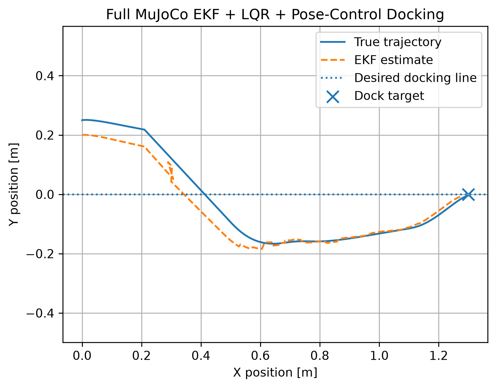

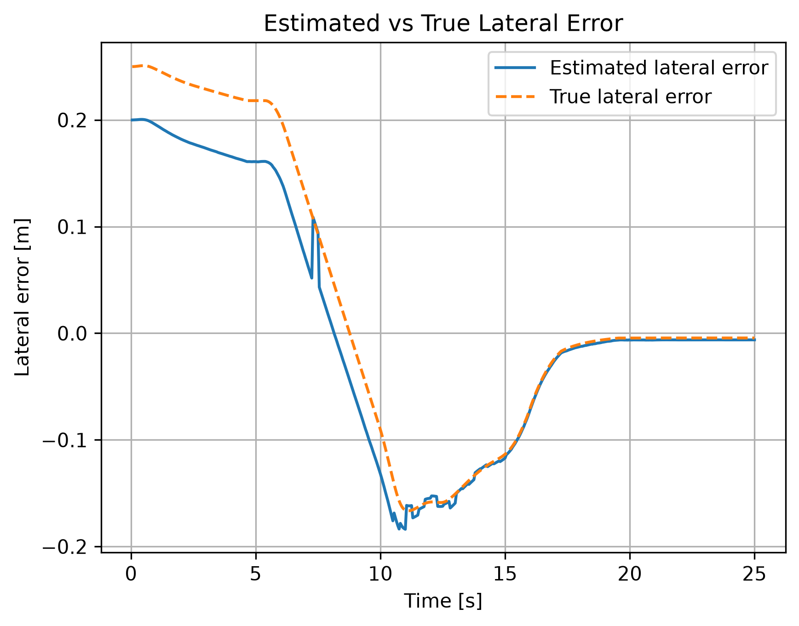

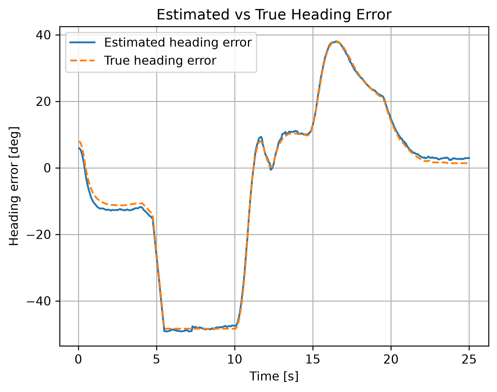

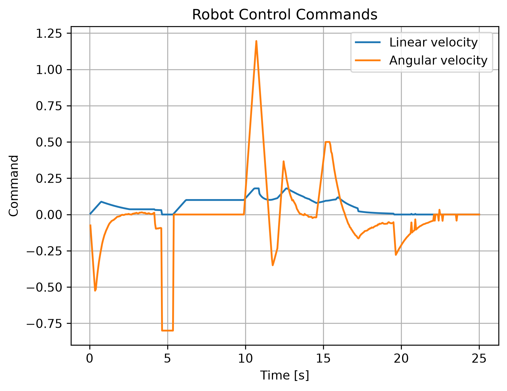

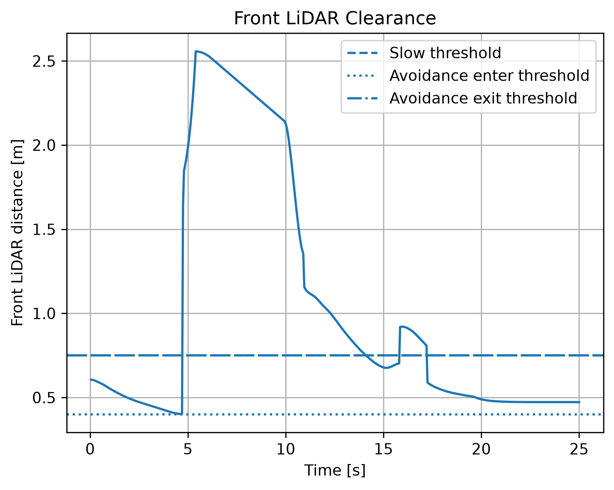

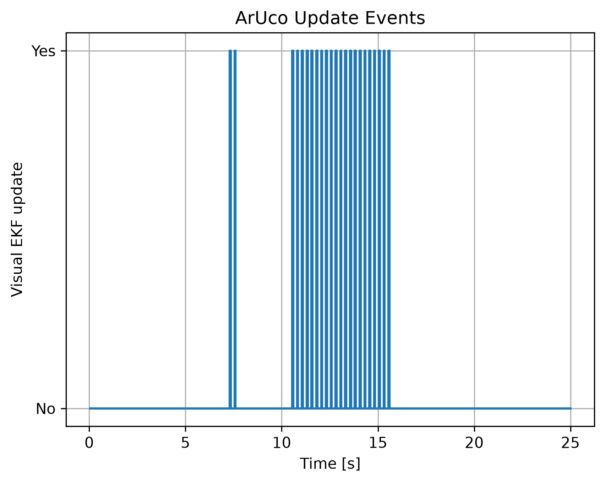

---

## 7. Nominal vs obstacle comparison

The comparison script reads the final nominal and obstacle metrics and generates the comparison plots under `results/comparison/`.

| Metric | Nominal | Obstacle |
|---|---:|---:|
| Camera / EKF updates | 80 | 23 |
| Final localisation error | 0.01237 m | 0.02003 m |
| Position RMSE | 0.02743 m | 0.03912 m |
| Lateral RMSE | 0.08874 m | 0.13791 m |
| Heading RMSE | 9.537° | 25.951° |
| Final planar docking error | 0.00878 m | **0.00488 m** |
| Final heading error | −2.351° | 2.258° |

The obstacle case increases transient localisation and tracking error because the robot deliberately departs from the nominal path during avoidance. Despite that disturbance, it recovers and finishes with a planar docking error of approximately **4.9 mm**, compared with approximately **8.8 mm** in the nominal run.

### Comparison figures

#### Trajectory comparison

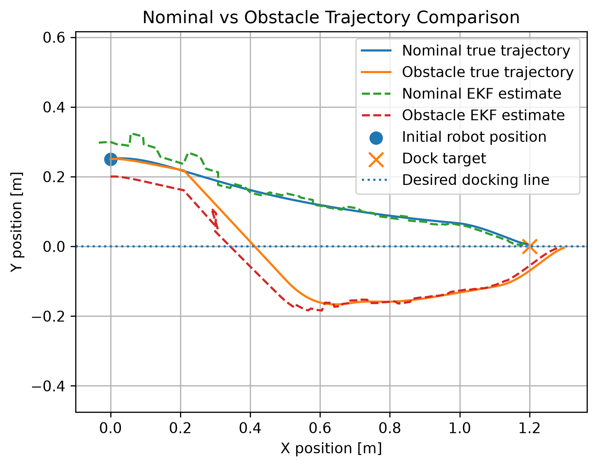

#### Localisation RMSE comparison

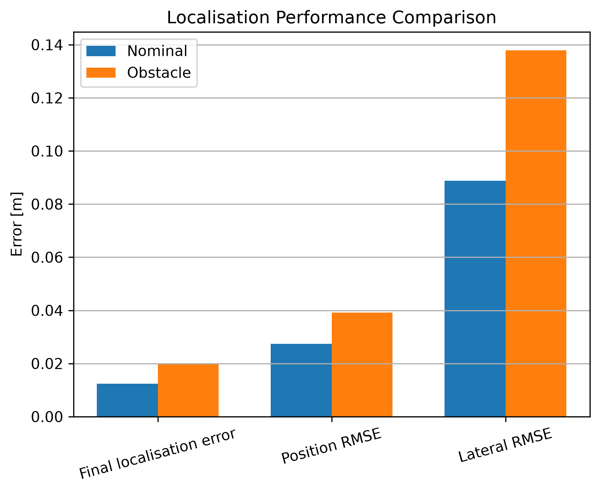

#### Docking error comparison

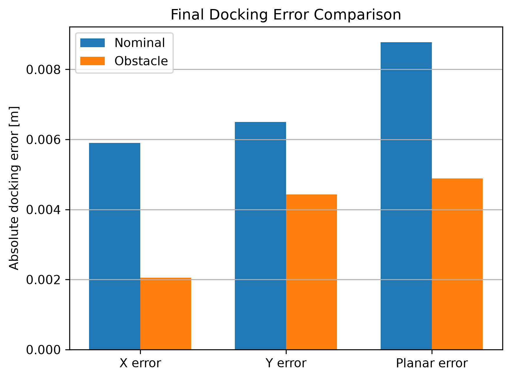

#### Heading error comparison

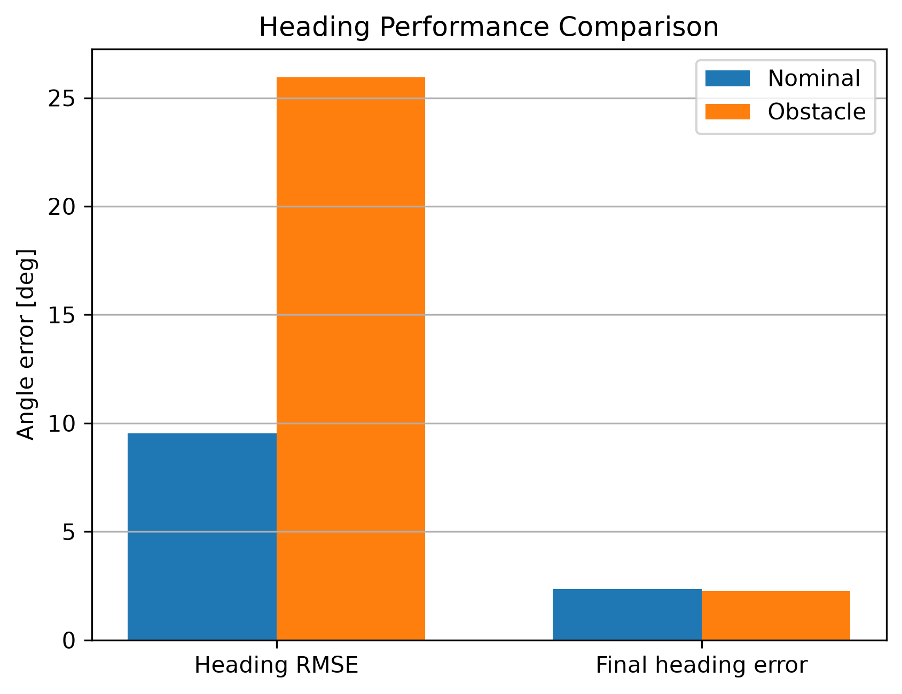

#### Camera update comparison

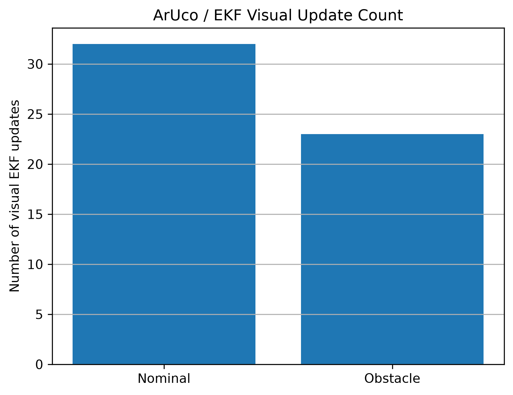

---

## 8. Installation

Tested development environment:

- Python 3.11.9
- Git
- VS Code
- MuJoCo
- NumPy
- SciPy
- Matplotlib
- OpenCV / ArUco

From a fresh clone:

```powershell
git clone https://github.com/gilmartinguape-bit/41014-Final-Project-Track-A.git
cd 41014-Final-Project-Track-A
```

Create and activate the virtual environment:

```powershell
python -m venv .venv
.venv\Scripts\activate
```

Install dependencies:

```powershell
python -m pip install --upgrade pip
pip install -r requirements.txt
```

---

## 9. Run instructions

Run commands from the repository root.

### Nominal docking simulation

```powershell
python -m scripts.simulate_mujoco_nominal
```

Outputs are written to `results/nominal/`.

### Obstacle docking simulation

```powershell
python -m scripts.simulate_mujoco_obstacle_trial
```

Outputs are written to `results/obstacle/`.

### Regenerate the final comparison

```powershell
python -m scripts.compare_final_results
```

Outputs are written to `results/comparison/`.

---

## 10. Repository structure

```text
41014-Final-Project-Track-A/
├── assets/                 # MuJoCo worlds and TurtleBot3 Waffle Pi meshes
├── src/                    # Model, sensors, EKF, controller, LiDAR and vision modules
├── scripts/                # Nominal, obstacle and comparison scripts
├── results/
│   ├── nominal/
│   ├── obstacle/
│   └── comparison/
├── requirements.txt
├── screenshot.png
└── README.md
```

---

## 11. Contribution statement

| Team member | Contribution |
|---|---|
| Gil Martin A. Guape | Developed and integrated the differential-drive simulation, EKF estimator, LQR and final-pose control workflow, LiDAR obstacle-avoidance logic, TurtleBot3 Waffle Pi MuJoCo environment, command-smoothing refinements, simulation testing, quantitative evaluation, visual outputs and project documentation. |

The complete sensing–estimation–control pipeline is understood as an integrated system for the individual viva voce.

---

## 12. Generative AI declaration

Generative AI was used as a support tool during project development. Final engineering decisions, code retained in the repository, executed results and explanations remain the responsibility of the student.

| Tool | Purpose | Verification |
|---|---|---|
| OpenAI ChatGPT | Coding guidance and debugging support; explanation of EKF/LQR and sensing concepts; assistance refining the MuJoCo simulation; README/documentation drafting; viva preparation | Suggestions were checked against project requirements, source code and executed simulation outputs before being retained. |

AI-generated suggestions were not treated as simulation evidence. Quantitative values reported on this page come from the executed project scripts and saved result files.

---

## 13. Limitations and hardware transition

The MuJoCo implementation demonstrates the complete simulation pipeline, but hardware testing can introduce wheel slip, motor deadband, camera-calibration error, sensor latency, frame misalignment and different noise characteristics.

Two simulation-specific details require attention before hardware deployment:

1. The current MuJoCo safety implementation can identify named geometries such as `obstacle_1` and the docking panel. Physical hardware cannot use simulator geometry names, so obstacle classification must instead use LiDAR range sectors and geometric thresholds.
2. The simulated LiDAR rays are generated from known planar robot pose. On hardware, LiDAR measurements are expressed in the sensor frame and must be transformed using the calibrated sensor-to-body transform.

The intended hardware architecture remains:

```text
Sensors → EKF → Estimated State → Nominal Controller → Safety Layer → Robot
```
